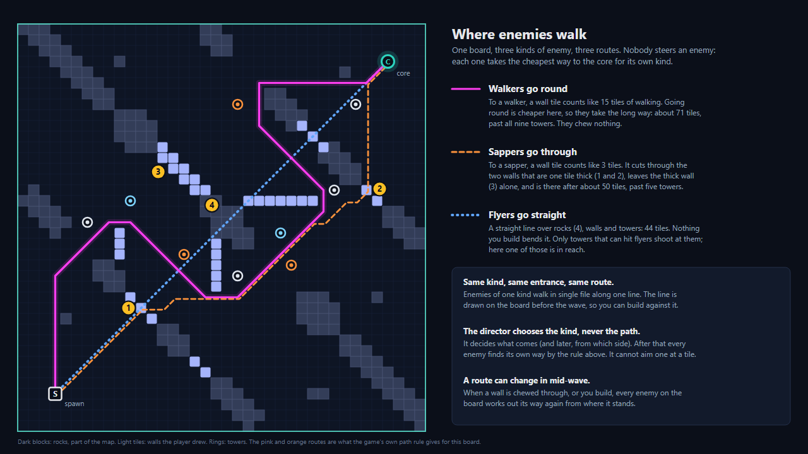
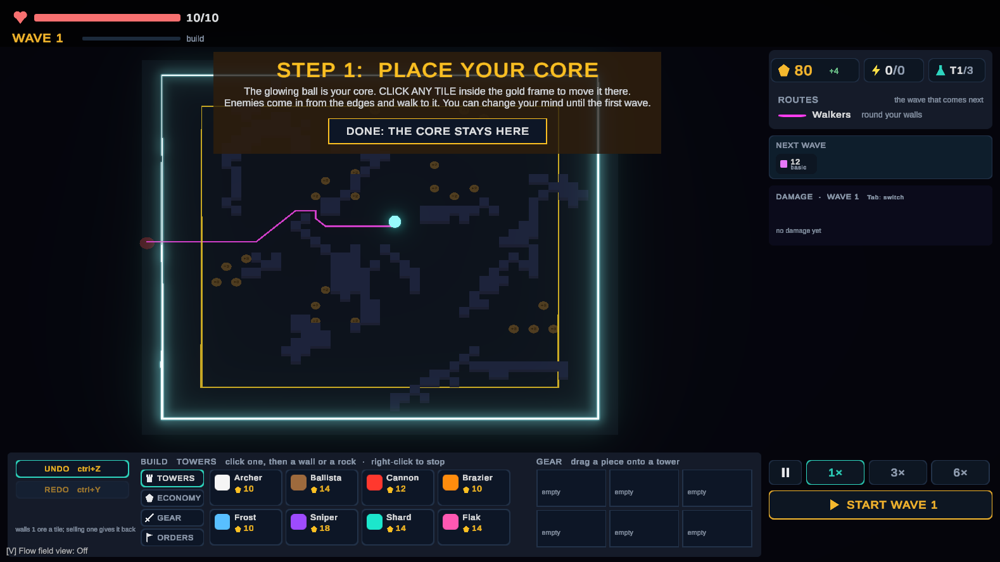
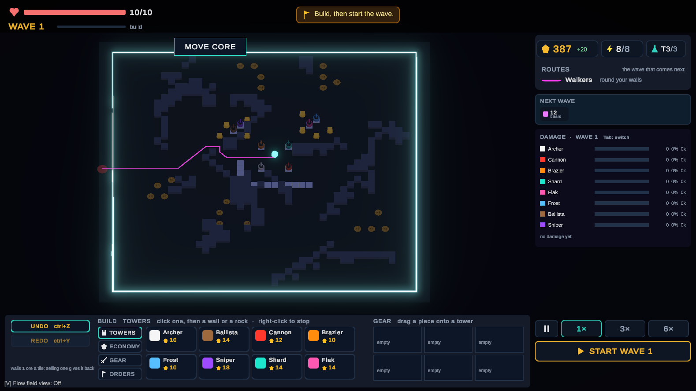
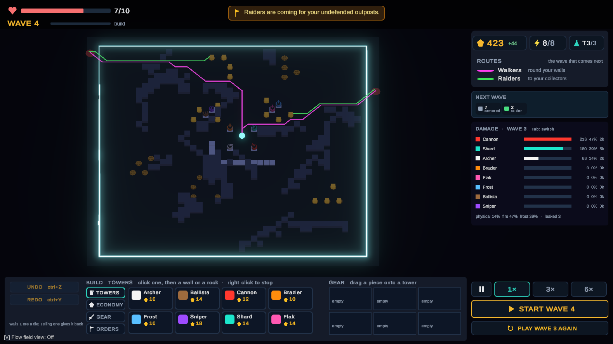
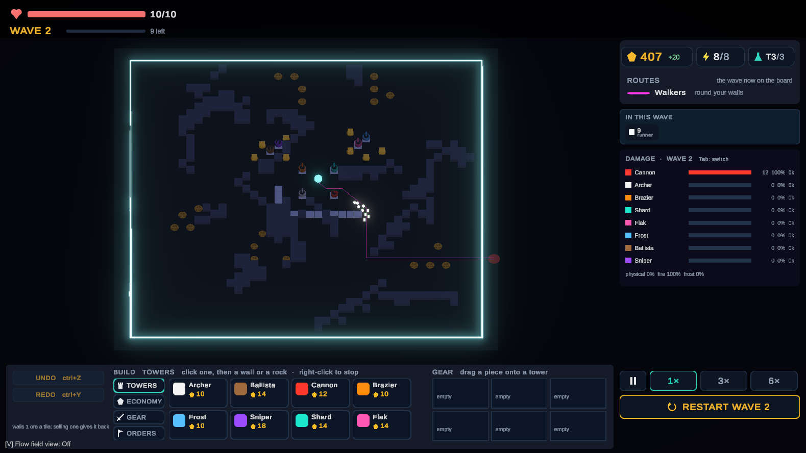
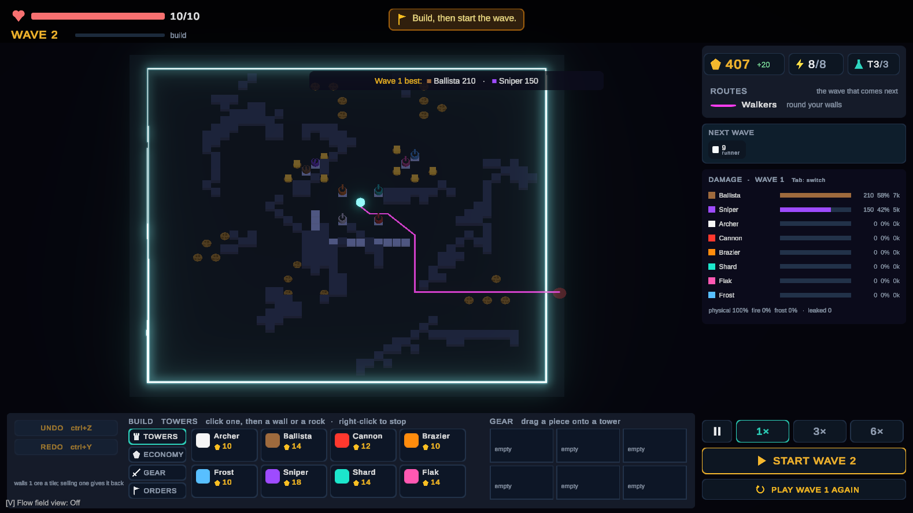
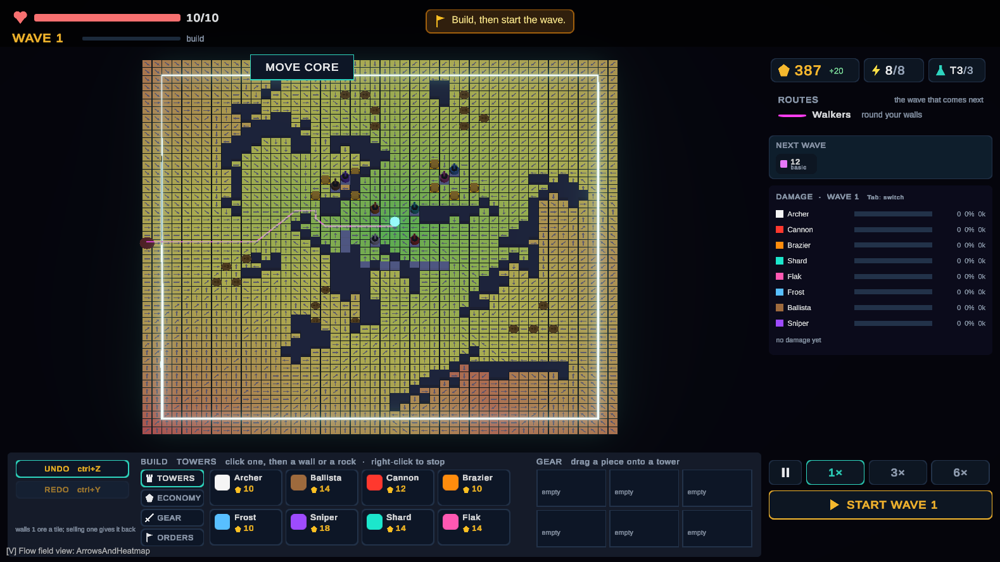

# GDD.md — game design document

**Rewritten 2026-10-28** for the game as it plays today in `ArknightsTest`. The first version
(2026-10-12) described a 24 × 24 board with a random tower shop; since then the game has been
reworked in rounds after play tests (cards, tower levels and gear; a generated map with several
entries; towers on walls; the ore economy and the build menu; power; upgrade paths; wall tiers
and breakable mountains; a development director). Each round is an entry in `DEVLOG.md`, and
the first version is in git (`132d8ca`). No name has been chosen for the game yet (§12,
question 12).

This file describes the game from the player's side: what is on the screen, what the player
does, and what the finished game is meant to be. The other documents answer other questions:
`CLAUDE.md` says what the thesis claims and what must never be broken, `ARCHITECTURE.md` how
the code is built, `WORKPLAN.md` in what order, and `Docs/proposal/` is the thesis proposal.
Where this file and `CLAUDE.md` disagree, `CLAUDE.md` wins.

Every part of this file carries one of four marks:

| Mark | Meaning |
|---|---|
| **Built** | In the game today, and tested. |
| **Planned** | Decided and in the work plan. Not built. |
| **Proposed** | A suggestion made in this file, so that there is something concrete to look at. Not decided. Accept it, change it or drop it. |
| **Open** | Nobody has decided. §12 lists every open question, with who must answer it and by when. |

**Every number in this file is a first guess** checked by the next tester session, not a
balanced value. The game's numbers live in `Assets/Scripts/Config/SimConfig.asset` (exported to
`Maps/SimConfig.json`) and the towers in `Maps/Towers.json`.

---

## 1. The game in short

A single-player maze tower defense on a map generated from a seed. You place your core, claim
ore deposits with collectors, draw walls to bend the enemies' route, and put towers on your
walls and on the rocks to shoot them. Enemies come in from the edges of the map, one to three
entry points a wave, and head for your core, or for your collectors.

The unusual rule: **nothing you build blocks the path.** Every wall, tower, collector and even
the mountains can be chewed through. An enemy takes the cheapest way to its goal, and "chew
through this" is priced into that choice like any detour. So you never close a route; you make
it long and expensive, and you put towers along it.

Waves come one after another, each stronger than the last. Before each wave you build, upgrade,
move and sell; the wave starts when you press Start. The session ends when the core has lost
its ten hit points.

**What the thesis adds.** The game exists in two versions that differ in one thing only. In the
*static* version the waves follow a fixed plan by wave number. In the *adaptive* version a wave
director looks at what you built, picks the kind of wave that presses on that build's weak
point, and tells you so before the wave. Both versions send waves of the same total strength.
The claim to be tested is that the adaptive version keeps a player rebuilding, where the static
one lets them find one good layout and repeat it.

### Design pillars

1. **You bend the path, you never close it.** A path to the core always exists.
2. **Three levers, one resource.** Towers are damage. Walls are time under fire. Collectors are
   income, and they stand where the ore is, away from the core. Walls alone kill nothing.
3. **Every wave asks a question about your build**, and says the question out loud.
4. **Fair.** Whatever the director sends has the same strength as the static wave of that
   number, and the director never touches your prices, your towers or your ore (§7.4).
5. **Readable.** The routes are drawn (§6.4), the next wave is shown before you start it, a
   tower shows the tiles it reaches before you pay, and an enemy shows its health.

---

## 2. One session, one wave

```
 BEFORE WAVE 1    place the core anywhere inside the gold frame (Done: the core stays here)
   ▼
 BUILD PHASE      no clock: it lasts until you press Start
   │              the next wave is already planned and shown: its enemies, its route lines,
   │              and (adaptive version) the director's line in the banner
   │              build · upgrade · move towers · sell · research · undo and redo
   ▼
 THE WAVE         enemies come in at one to three edge points
   │              towers fire · enemies walk the route, or chew through what is in the way
   │              you may still build; you may not sell or move towers
   ▼
 THE WAVE ENDS    when the last enemy has been killed or has reached its goal
                  income is paid · the next wave is planned · a new build phase begins
```

**Built**, all of it. A wave can be restarted from its start at any time after it began, with
everything you built for it still standing (RESTART WAVE n, or PLAY WAVE n AGAIN in the build
phase after it).

---

## 3. The map

### 3.1 Generated from the seed

**Built** (2026-10-13, enlarged 2026-10-20). Every session starts from a seed, and the map is
made from it (`MapGenerator`):

- **48 × 48 tiles.** A two-tile ring at the edge is the enemies' ground: nothing is built on it.
- **22 ridges of rock** (mountains, §3.3), so the board is never empty and never the same.
- **28 ore deposits** in clusters of four, at least one cluster near the middle.
- **Entry points** all round the edge. A wave uses one in the first waves, two from wave 4 and
  three from wave 8, each with a walk of at least 12 tiles to the core and at least 10 tiles
  apart.

Today every session gets a new random seed. **Planned:** the study uses two fixed seed sets,
crossed with the condition and the order (decision D9), so both versions are played on the
same maps.

### 3.2 The view

**Built.** An orthographic camera tilted 52° from the horizon, so towers read as figures
standing on the board; the board keeps one tile size from the near edge to the far one. The
mouse wheel zooms toward the mouse, WASD or the arrow keys move the view.

### 3.3 Mountains

**Built** (breakable since 2026-10-28). The rocks are mountains: very tough terrain.

- A tower may stand on a mountain (§5.2). Nothing else is built on one.
- To an enemy on foot a mountain counts like 60 tiles of walking and takes 60 seconds to chew,
  ten times a plain wall. It goes round unless going round is longer still. A sapper pays the
  full price too, so sappers do not tunnel the same mountain every time.
- A broken mountain is gone for the rest of the session. It cannot be sold and pays nothing.
  A tower standing on it is destroyed when it is chewed through; the mountain under it stays.
- Flyers pass over mountains.

---

## 4. Ore

**Built** (the ore economy, 2026-10-20). There is one resource, ore. You start with 80.

| | Ore |
|---|---|
| At the start | 80 |
| After every wave, from the core | +4 |
| After every wave, from each standing collector | +2 near the middle, up to +4 near the edge |
| A collector | −6 |
| Kills, chewed walls, destroyed towers | nothing |
| Selling something bought in this build phase | all of it back |
| Selling something older | half back |
| A collector destroyed by enemies | half its price back at once |
| Repairing the core | −10 for 3 hit points |

- **A deposit holds 30 ore**, then it runs dry. A collector on an empty deposit earns nothing,
  and an empty deposit takes no new collector. The deposit shows what is left.
- **A collector is terrain**, like a wall: it counts like 20 tiles of walking and takes 8
  seconds to chew. A destroyed collector pays nothing for that wave.
- **Power.** A tower fires only while it is powered. The core powers up to 4 towers within 4
  tiles, each collector up to 2 within 3, a pylon up to 2 within 3 (§5.5). As many towers as
  possible get power. Selecting a source shows the tiles it reaches and lines to the towers it
  powers; clicking a tower in its reach ties the tower to it. When raiders destroy a collector,
  the towers it powered go dark at once.

What it is for: the stack of towers round the core, which beat everything in the first play
tests, now has a cost. Income stands where the ore is, spread over the map, and has to be
defended or lost.

---

## 5. What you build

Everything is bought from the **build menu** in the bottom bar, by category: TOWERS, ECONOMY
(collector, pylon, research, repair), GEAR and ORDERS (walls, sell, move, upgrade, target).
Hovering a button shows its card. **There is no random shop** since 2026-10-20: every price is
fixed and everything is on offer from the start, except what research unlocks.

### 5.1 Walls

**Built.** A wall is one tile, drawn with a click, or a line of them with a drag (Q).

| Wall | Price | To an enemy on foot it counts like | Seconds to chew |
|---|---|---|---|
| Wall | 1 | 15 tiles of walking | 6 |
| Stone wall | 3 | 30 | 18 |
| Fort wall | 5 | 45 | 36 |

A wall goes on any free tile that is not a mountain, a deposit, the core or the edge ring. The
tile under the mouse shows whether the spot is legal before you click; the preview and the click
use one rule, so they can never disagree. A sapper pays a fifth of a wall's price (a plain wall
counts like 3 tiles to it).

- **Thickness is the first thing to watch.** One plain wall tile costs a walker 15 tiles' worth
  to cross; two cost 30.
- **Length is the second.** Walkers go round only while going round is cheaper than chewing.
  Stretch the detour too far and they chew through the thinnest spot instead.

### 5.2 Towers

**Built.** A tower stands **only on a wall or a mountain**: build the wall first, then the tower
on it. It fires only while powered (§4). It picks its target by its target order (first, strongest,
weakest, nearest, raiders first; T), hits at once, and waits for its next shot.

| Tower | Price | Damage type | Damage | Every | Range | Also | Hits flyers |
|---|---|---|---|---|---|---|---|
| Archer | 10 | physical | 6 | 0.5 s | 4 | | yes |
| Ballista | 14 | physical | 32 | 2 s | 5 | | no |
| Cannon | 12 | fire | 6 | 1.2 s | 3 | splash 0.75 | no |
| Brazier | 10 | fire | 0.8 | 0.1 s | 2 | splash 0.5 | no |
| Frost | 10 | frost | 0.5 | 0.6 s | 2.5 | splash 1; slows to 40 % for 1.5 s | no |
| Sniper | 18 | physical | 40 | 3.2 s | 8 | | no |
| Shard | 14 | frost | 5 | 0.6 s | 3.5 | three targets | no |
| Flak | 14 | fire | 2.5 | 0.8 s | 4.5 | splash 0.75 | yes |

Every tower can be built from the start. Towers can be **moved** freely in a build phase (M),
and **sold** (X).

### 5.3 Upgrades and research

**Built** (2026-10-27). Every tower has **three upgrade paths of two steps**. The first upgrade
picks a path; the second can only be that path's next step. A tower with one upgrade is rare,
with two epic. The first upgrade costs 12 ore, the second 20.

**Research** opens upgrades: at tier 1 no tower can be upgraded, tier 2 (15 ore) allows a
tower's first upgrade, tier 3 (30 ore) its second.

| Tower | Paths (first step / second step) |
|---|---|
| Archer | Ranger: shoots 2 / 3 enemies · Hawkeye: ×2 / ×3 damage to flyers · Marksman: every 3rd shot ×3 / ×5 |
| Ballista | Breaker: ignores armour / pierces 3 · Executioner: finishes under 20 % / 35 % · Skyward: hits flyers / fires 40 % faster |
| Cannon | Mortar: +2 range / bigger blast · Incendiary: sets burning · Concussion: slows |
| Brazier | Inferno: more damage, burning · Bonfire: pulls enemies within 4 tiles (lure) · Smoke: slows, then exposes |
| Frost | Deep freeze: slows to 25 % · Brittle: enemies take +25 % / +50 % · Ice spikes: flat damage |
| Sniper | Assassin: every 2nd shot ×2, execute · Anti-air: hits flyers · Spotter: ignores armour, exposes |
| Shard | Splinter: more shards · Frostbite: slows, then brittle · Lance: one big shard |
| Flak | Barrage: faster, two targets · Skybreaker: ×2 / ×4 damage to flyers · Fire shells: burning, heavier |
| Pylon | Grid: powers 1 / 1 more · Relay: reaches 1 / 1 tile further · Beacon: collectors nearby pay +1 ore |

### 5.4 Gear

**Built** (flat gear since 2026-10-27). A tower has gear slots; gear is crafted from the GEAR
tab at half its list price and dragged onto a tower.

| Gear | Does | Ore |
|---|---|---|
| Scope | +1 range | 4 |
| Far scope | +2 range | 9 |
| Edge | +1 damage a second | 4 |
| Keen edge | +3 damage a second | 10 |
| Extractor | takes a tower's gear off | 2 |

Damage gear adds damage *a second*, once a shot to the first target and never multiplied by a
crit or a volley, so it is worth the same on every tower.

### 5.5 The pylon

**Built.** 18 ore. It does not shoot: it powers up to 2 towers within 3 tiles, and has power
itself. It may not stand within 5 tiles of the core (cheap power for outposts, not for a stack
round the core). Its upgrades add one tower or one tile each (at most 4 towers, as the core).

### 5.6 Changing your mind

**Built.** Undo and redo (Ctrl+Z, Ctrl+Y) go back up to 30 steps within the build phase.
Anything sold in the build phase it was bought in gives all its ore back.

---

## 6. Enemies

### 6.1 What an enemy is

**Built.** An enemy has hit points, a walking speed, a digging speed, and one resistance per
damage type. It ends in one of two ways: **killed** (nothing is paid) or **through** to the core
(the core loses 1).

### 6.2 Three ways of moving

**Built** (WP-C2). This is what the director's wave types are made of.

| Class | How it gets to its goal | Digs | Which towers can hit it |
|---|---|---|---|
| **Walker** (ground) | The cheapest way, counting a plain wall as 15 tiles of walking. Usually goes round. | Only when going round costs more. | All |
| **Sapper** | The same, but your walls count a fifth (mountains full price). Goes through walls that walkers go round. | Often, and faster. | All |
| **Flyer** | A straight line to the core, over everything. | Never. | Only towers that hit flyers |

Two behaviours come on top of a class:

- **Raiders** go for your collectors, the nearest first, then the next, then the core.
- **Siege enemies** stop as soon as a tower is within 4.5 tiles, set up for 2 seconds, then every
  1.5 seconds shell the tower with the most towers round it, and the towers next to it. A tower
  that has taken 10 is knocked out until the next build phase, never destroyed. Towers that
  outrange them (ballista, sniper, range upgrades), slows and spreading out are the answers.

A tower with the lure ability (the brazier's Bonfire path) pulls enemies on foot within 4 tiles.

### 6.3 Enemy types

**Built.** Each type is a set of numbers on top of the plain walker of that wave.

| Type | Class | Compared with the plain walker |
|---|---|---|
| Basic | walker | the baseline |
| Swarm | walker | twice as many, 0.4 the hit points, 1.3 times as fast, closer together |
| Runner | walker | 0.8 as many, 0.6 the hit points, 1.7 times as fast |
| Brute | walker | a quarter as many, 4 times the hit points, 0.7 as fast |
| Armored | walker | takes 35 % of physical damage; 1.2 times the hit points |
| Ember | walker | takes 25 % of fire damage |
| Sapper | sapper | half as many, 1.5 times the hit points, digs 4 times as fast |
| Flyer | flyer | half as many, 0.35 the hit points |
| Bats | flyer | many, 0.15 the hit points, 1.2 times as fast |
| Raider | walker, raids | half as many, 1.2 times as fast, digs 1.5 times as fast |
| Siege | walker, siege | 6 times the hit points (3 times at first, §7.2), 0.6 as fast |
| Frostborn | walker | immune to frost; kept for the tests, no longer sent (too strong) |

### 6.4 Where enemies walk



**Built.** The picture is an example board from the first version of this file; the rule it
shows is unchanged. The pink and the orange route were not drawn by hand: they are what the
game's own path rule gives for that board.

**Nobody assigns a path to an enemy.** There is one rule, and every enemy follows it on its own:
*at every step, go to the neighbouring tile from which the rest of the way to my goal is
cheapest for my kind.* A flyer does not use the rule at all; it flies a straight line.

- **Same kind, same entrance, same route.** The walkers of one entry walk one line.
- **Different kinds, different routes, on the same board.** In the picture the walkers go round
  every wall (about 71 tiles, past 9 towers), the sappers through the two thin walls (about 50
  tiles, past 5), the flyers straight over (44 tiles, past 1). One layout is several different
  problems, depending on what arrives. That is what the director works with.
- **The director chooses the kind and the entries, never the path.** Wherever an enemy goes, you
  could have read it off your own board.
- **A route can change in the middle of a wave**, when something is chewed through or you build.
- **A route is never closed.** Wall off every gap, and the wave chews through the cheapest spot.

<!-- pdf: figures here -->

**What the screen shows.** **Built:** in a build phase, one line for each kind of enemy in the
next wave, from its entry; raiders' lines go to the collector they reach first. During a wave,
the lines of the kinds in that wave. The lines follow the enemies' own step rule, so they bend
to a lure as the enemies do.

---

## 7. Waves

### 7.1 The static version

**Built** as the baseline the director starts from. The plain walker of wave *n*: 12 enemies in
wave 1 and one more every two waves; hit points 30 + 4.5 a wave, then 4 % more a wave on top;
speed 1.25 tiles a second, 0.0375 more a wave, at most 2.25.

Each wave is made of one to three types in a fixed twelve-wave cycle (basic; runners; sappers;
armored; flyers; swarm; brutes and basic; ember and sappers; bats; swarm and runners; armored
and flyers; brutes, swarm and bats). On the ore map raiders come too, from wave 4, every few
waves. **Open (question 21):** whether the study's static version keeps this cycle, or sends
plain walkers only.

### 7.2 The development director

**Built** (2026-10-26, rewritten 2026-10-28). What the game runs today. It is **not** a study
condition and **not** the thesis director: it has no learning, no build profile and no price
list that keeps every wave type equally strong.

At the start of each build phase it reads the board and gives each kind of wave a score; the
highest is sent, and a kind sent last wave loses a little:

| Wave | What arrives | Sent when |
|---|---|---|
| Baseline | the wave of §7.1 | nothing below scores higher |
| Outpost raid | raiders, 15 to 40 % of the wave | collectors that no tower covers (from wave 4) |
| Siege stack | one to three siege enemies | most of the damage comes from one cluster of towers (from wave 8; one alone for the first three siege waves) |
| Resist mix | armored or ember enemies, 40 % | one damage type is over 60 % of your damage |
| Air raid | flyers, 40 % | less than a quarter of your damage can hit flyers (never when none can) |
| Maze breach | sappers, 30 % | a long wall maze: 10 or more walls, and the route 1.4 times the straight line (the only time sappers come) |

At least half of every wave still goes for the core. The banner shows one written line for the
chosen kind, e.g. "Raiders are coming for your undefended outposts."

### 7.3 The adaptive version

**Planned** (WP8 to WP11).

**What the director looks at.** At the start of each build phase it measures five things:

| Measure | In plain words |
|---|---|
| maze length | how much longer the route is than on an empty board |
| breach vulnerability | how much of the route depends on walls or towers that could be chewed through |
| chokepoint reliance | whether your damage is done in one spot or spread along the route |
| tower concentration | whether your towers stand together or apart |
| damage type mix | whether your damage is one type or several |

Their exact formulas are **Open** (question 5).

**What it can send.** One of a small set of wave types, each meant to press on one weakness:
the proposal's four (breach the thin wall, swarm the chokepoint, split groups, flying bypass)
and the development director's kinds (§7.2) are the candidates. The final set is **Open**
(question 4). Which builds each type really moves a player to change is not a rule of the
game: it is what the study measures.

**How it chooses.** It starts from written scores, as the development director does. On top of
them it learns, during your session, which wave types actually made *you* rebuild, and nudges
close calls that way, by at most one point. It is rewarded for a rebuild, not for beating you:
a wave that ends your session scores badly, because a player who is out builds nothing more.

### 7.4 What keeps it fair

Fixed rules of the project (`CLAUDE.md` §4):

- **Same strength.** Every wave type costs exactly what the static wave of that number costs, on
  one shared price list. The director chooses the shape of a wave, never its size.
- **Nothing that cannot be answered.** Flyers are not sent while no tower can hit them.
- **No repeats in disguise.** A wave too similar to the previous one is ruled out.
- **Hands off your side.** The director never changes a price, a tower or your ore. **Open
  (question 6):** raiders destroy collectors and siege enemies knock towers out, so a wave type
  that sends them changes your income and firepower, which the static version does not.

### 7.5 What is the same in both versions

The map and its seed, every price, the strength of every wave, and the screen. Only the shape of
the waves differs, and with it the banner's line and which route lines are drawn.

---

## 8. Losing, restarting, a session

**Built.** The core has 10 hit points and loses one for every enemy that reaches it. At zero the
game is over: "You reached Wave N", and Restart. There is no way to win today.

**Built:** a wave can be restarted any number of times (§2). **Open (question 22):** whether a
participant may restart waves in the study, since a restart replays the director's choice and
changes how many waves count.

**Open (question 1): how long is a session?** The study compares the waves a player completed in
each of their two sessions, cut to the shorter one, so it needs a stated length (about 25 waves
is assumed) and a game in which an ordinary player gets most of the way there.

**Planned (WP14): a study session.** The participant types a code on a start screen; the code
decides their two sessions (one static, one adaptive, two different seeds, in a counterbalanced
order).

---

## 9. What the screen looks like

### 9.1 Today

**Built.** The pictures are from the game on 2026-10-28.

### Placing the core



Brown discs are ore deposits, dark tiles mountains; the pink line is the first wave's route.

### A build phase



Top left: the core's health and the wave. Top centre: the banner. Top right: ore and income,
powered towers, research tier; under them the route key, the next wave's enemies as chips, and
the damage panel. Bottom: the build menu by category, the gear slots, undo and redo; bottom
right pause, speed (x1, x3, x6) and the wave button.

### The director's warning



Unguarded collectors drew a raid: the banner says so, the chips show 7 armored and 2 raiders,
and the raiders' route (green) runs to the collectors.

### A wave



### After a wave



The damage panel shows each tower's share; the three best are named at the top for a few seconds when a wave ends.

### The flow-field view (V)



For development: the cost to the core of every tile, as colour, and the way out of it, as an
arrow.

### 9.2 Still to come

| Screen | Status |
|---|---|
| Session start: participant code | **Planned** (WP14) |
| Director overlay (F9): why the director chose what it chose; development only | **Planned** (WP14) |
| Preview of how the routes would change before a wall is paid for | **Planned** (second-semester UX pass) |
| Art: models for towers and enemies, sound | **Open** (question 13) |

---

## 10. Controls

**Built.**

| Action | How |
|---|---|
| Build | pick it in the bottom bar, then click a tile; walls by click or drag |
| Build-menu tabs | click, or 1 to 4 |
| Wall tool | Q |
| Collector | C |
| Sell | X, then click (drag over walls) |
| Move a tower | M, or drag the tower |
| Upgrade | U, or the inspect pane |
| Target order | T, or the inspect pane |
| Put the hand down | Esc, or the right mouse button |
| Undo, redo | Ctrl+Z, Ctrl+Y |
| Select a tower, collector, pylon or the core | click it |
| Start the wave | the wave button |
| Game speed | x1, x3, x6 buttons, or 1, 2, 3 |
| Pause (during a wave only) | Space |
| Damage panel: this wave, the whole game, folded | Tab |
| Move the view, zoom | WASD or arrows, mouse wheel |
| Flow-field view | V, for development |

**A clash to fix:** the keys 1 to 3 change the game speed *and* the build-menu tab at the same
time (question 23).

---

## 11. Look and sound

**Look.** **Built**, as a placeholder: a dark board with a glowing edge; towers as figures with a
colour each (white archer, brown ballista, red cannon, orange brazier, blue frost, violet sniper,
teal shard, pink flak, lime pylon); walls coloured by tier; the interface drawn in code, with no
art files. Enemies are coloured shapes.

**Sound.** **Open** (question 13). There is none.

---

## 12. Open questions

Each of these changes what the finished game is. "Suggestion" is this file's proposal, not a
decision.

| # | Question | Suggestion | Who decides | Needed by |
|---|---|---|---|---|
| 1 | **How long is a session, and what ends it?** | A fixed length of 25 waves; the session still ends early if the core falls; balance so that an ordinary player gets past wave 15. Reaching the last wave is the win. | you and your supervisor | the balance pass, firmly before the pilot |
| 4 | **Which wave types,** and what exactly is in each? (S10) | Pick four to six from the proposal's four and the development director's kinds (§7.3), one per weakness the profile can see. | you | WP9 |
| 5 | **The exact formulas of the five measures.** (S9) | Start from `ARCHITECTURE.md` §5.3 and the proposal's Table 7. | you | WP8 |
| 6 | **Raids and sieges change the player's income and firepower** (I11, S14). | Count raiders and siege enemies in the shared price list at the value of what they can destroy, or send the same raids in both versions. | you and your supervisor | WP9, before the pilot |
| 7 | **The banner in the static version.** | Both versions show one: the static one states the wave plainly ("Wave 7: armored and flyers"), the adaptive one also says why. | you and your supervisor | WP14 |
| 8 | **How does a participant learn the game?** | A short practice run of three waves on a third seed, static, not analysed. | you and your supervisor | the pilot |
| 12 | **A name for the game,** and the company and product name in the build settings. | — | you | the first build that records data |
| 13 | **Art and sound.** | Distinct shapes for enemy types and a handful of sounds in the UX pass, if there is time. | you | the second-semester UX pass |
| 14 | **May a participant pause and change speed?** | Yes to both. | you and your supervisor | the pilot |
| 20 | **Do research, upgrades and gear stay?** A tester called research the worst feature and gear a waste of ore (2026-10-23). | Keep upgrades (they are the towers' identity); decide research and gear after the next tests. | you | the balance pass |
| 21 | **What does the static version send?** The fixed cycle of types (§7.1), or plain walkers? | The cycle: otherwise the two versions differ in variety, not in adaptation. | you and your supervisor | WP9 |
| 22 | **Restarting waves in the study.** | Off in the study build, or counted and reported. | you and your supervisor | the pilot |
| 23 | **Keys 1 to 3** change the speed and the build-menu tab together. | Give the tabs other keys or none (they lost their labels on 2026-10-28). | delegated | the next round |

### Answered

| # | Question | Answer | When |
|---|---|---|---|
| 2 | Which towers? | Eight towers and the pylon (§5.2, §5.5). | 2026-10-24 |
| 3 | Which enemy types? | The eleven sent today (§6.3). | 2026-10-14 to -26 |
| 9 | Balance of chewed walls, refunds, rerolls | Chewed walls pay nothing; a sale gives half back, all of it in the build phase of the purchase; no shop, so no rerolls. | 2026-10-20 to -28 |
| 10 | Where do extra spawn points go? | All round the edge of the generated map; one to three a wave (§3.1). | 2026-10-13 |
| 11 | Is the "seeded maze" still wanted? | The map is generated from the seed (§3.1); the study's fixed seed sets keep both versions on the same maps. | 2026-10-13 |
| 15 | The walls | Single tiles by click and drag; three tiers since 2026-10-28. | 2026-10-12 |
| 16 | Rocks | Yes; generated, and breakable since 2026-10-28 (§3.3). | 2026-10-12 |
| 17 | One view for building and the wave? | Yes. The board is now seen at a tilt (§3.2). | 2026-10-14 |
| 18 | Which route lines are drawn? | One for each kind in the next wave in a build phase, the wave's kinds during it (§6.4). | 2026-10-12 |
| 19 | How big is the board? | 48 × 48 (§3.1). | 2026-10-20 |
| — | Is the warning enough? | The wave is planned and shown as the build phase begins, so the player answers it before Start. | 2026-10-12 |
| — | Cards, levels and gear | Replaced by the build menu, upgrade paths and flat gear. | 2026-10-20 to -27 |

---

## 13. From today to the finished game

| Package | What the player will notice |
|---|---|
| Gameplay rounds (**ongoing**, to the end of October) | Whatever the next tester sessions call for. |
| **WP7** the learner | Nothing. It runs without the game. |
| **WP8** build profile | Nothing. |
| **WP9** wave types and the price list | The final wave types; every wave of one number equally strong. |
| **WP10, WP11** the director | Waves that answer the build, learned per player. |
| **WP14** director on screen, session start | The participant-code screen; the director overlay for development. |
| **WP12, WP13** harness and gates | Nothing. |
| Second semester: UX pass, balance pass | Route previews, a clearer screen, a game that is fair to an ordinary player. |
| Build freeze | Nothing changes after this, except crash fixes. |

---

## 14. What this game is not

- **Not a game that gets easier or harder to suit you.** Difficulty is held equal on purpose;
  only the shape of the waves changes.
- **Not a game where walls block.** That was the original design and was removed; it is what
  makes "a path always exists" true.
- **Not a game of luck in what you can buy.** The random shop is gone; everything has a fixed
  price.
- **No generated text or behaviour.** Every banner line is written by hand, and every run can be
  replayed exactly.
- **Not in the plan:** anything carried over from one session to the next, more than one player.
