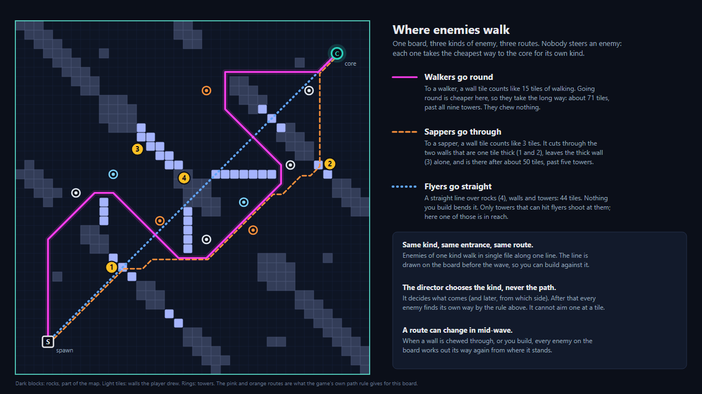
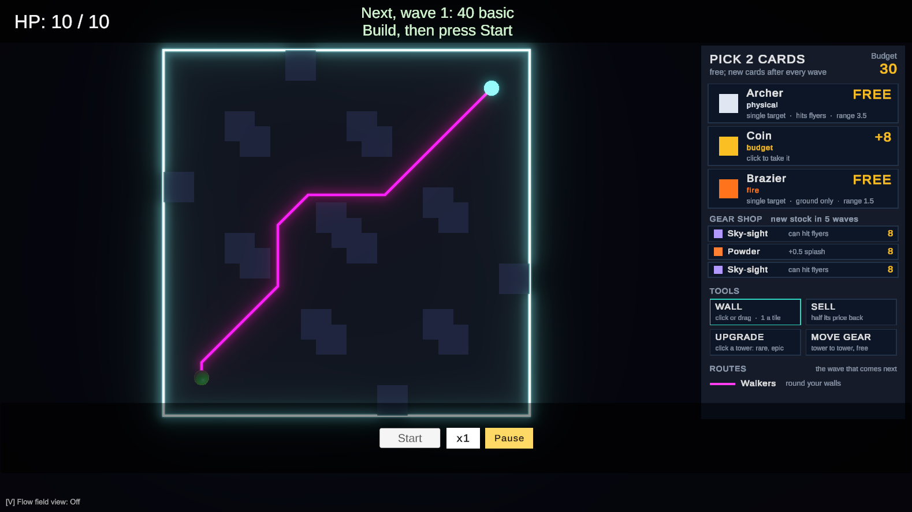
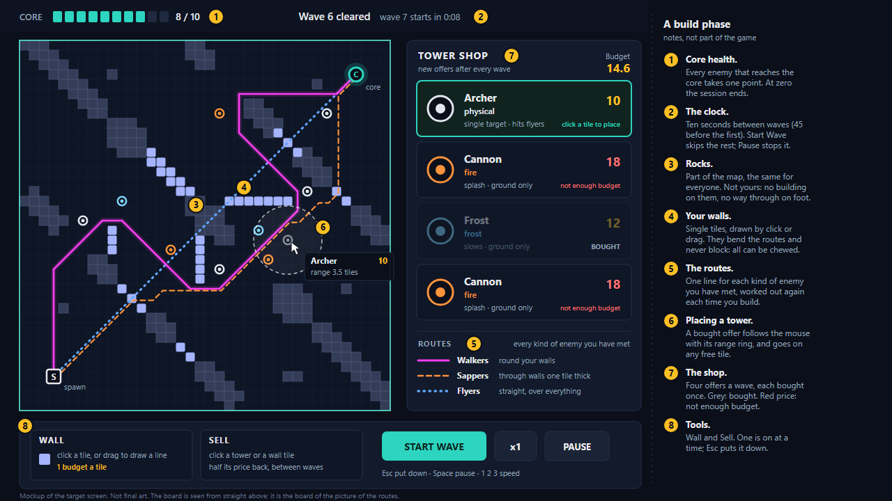
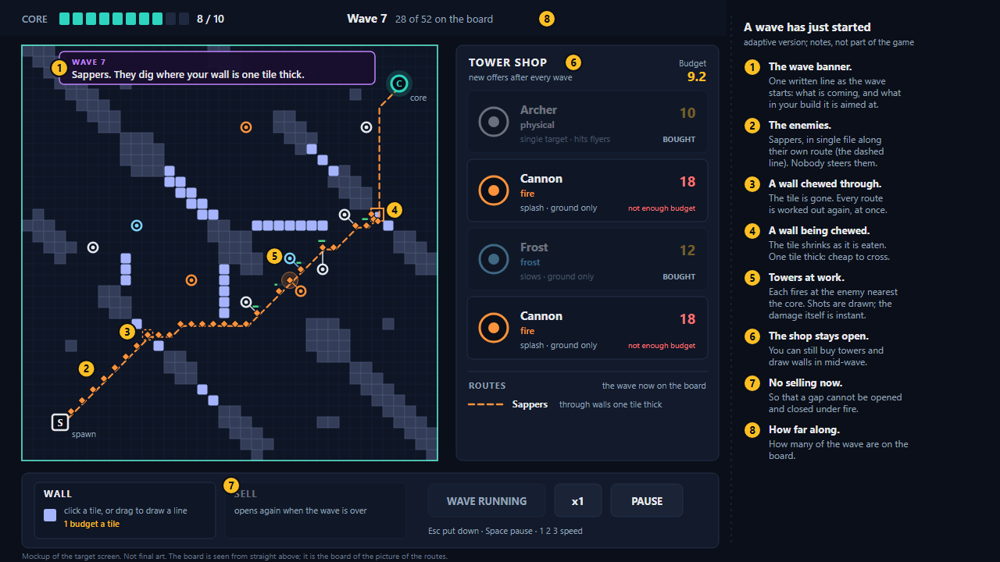

# GDD.md — game design document

**Written 2026-10-12, after WP-C3. Revised the same day** after your first read, and again
after WP-C4, which built the four things you decided then: the board is seen from straight
above, during a wave too (§3.1); walls are single tiles and no longer tetromino pieces
(§4.1); the map has rocks (§3.2); and the board draws a route line for every kind of enemy
you have met (§5.3, which also says where enemies walk). The board is 24 × 24 for now (§3.3).
WP-C5 then built the five towers and four enemy types this file proposed, with new wave
numbers (§4.2, §5.4, §6.1). After you played that, a trial of cards, tower levels and gear
was built the same day (§4.4). No name has been chosen for the game yet (§12,
question 12).

This file describes the game from the player's side: what is on the screen, what the
player does, and what the finished game is meant to be. The other documents answer other
questions: `CLAUDE.md` says what the thesis claims and what must never be broken,
`ARCHITECTURE.md` how the code is built, `WORKPLAN.md` in what order. Where this file and
`CLAUDE.md` disagree, `CLAUDE.md` wins.

Much of the finished game is not decided yet. So every part of this file carries one of
four marks:

| Mark | Meaning |
|---|---|
| **Built** | In the game today, and tested. |
| **Planned** | Decided and in the work plan. Not built. |
| **Proposed** | A suggestion made in this file, so that there is something concrete to look at. Not decided. Accept it, change it or drop it. |
| **Open** | Nobody has decided. §12 lists every open question, with who must answer it and by when. |

---

## 1. The game in short

A single-player maze tower defense on one square board, seen from straight above. Enemies
come out of a spawn in one corner and head for your core in the opposite corner. You have
one budget and spend it on two things:

- **walls** (single tiles that you draw onto the board), which bend the enemies' route;
- **towers** (bought from a shop that offers four at random), which shoot them.

The unusual rule: **nothing you build blocks the path.** Every wall and every tower can
be chewed through. An enemy takes the cheapest way to the core, and "chew through this"
is priced into that choice like any detour. So you never close a route; you make it long
and expensive, and you put towers along it.

Waves come one after another, each stronger than the last. Between waves you build, buy
and sell. The session ends when ten enemies have reached the core.


**What the thesis adds.** The game exists in two versions that differ in one thing only.
In the *static* version every wave is the same kind of enemy, just more and tougher. In
the *adaptive* version a wave director looks at what you built, picks the kind of wave
that presses on that build's weak point, and tells you so in one line. Both versions
send waves of the same total strength. The claim to be tested is that the adaptive
version keeps a player rebuilding, where the static one lets them find one good maze and
repeat it.

### Design pillars

1. **You bend the path, you never close it.** A path to the core always exists.
2. **Two levers, one budget.** Towers are damage. Walls are time under fire. Walls alone
   kill nothing.
3. **Every wave asks a question about your build**, and says the question out loud.
4. **Fair.** Whatever the director sends, it has the same strength as the static wave of
   that number, and the director never touches your shop, your prices or your money.
5. **Readable.** The routes are drawn (§5.3). A tower shows its range before you pay for the tile.
   An enemy shows its health. Nothing important is hidden in a number.

---

## 2. One wave, from start to finish

```
 BUILD PHASE      45 seconds before wave 1, 10 seconds after every wave
   │              draw walls · buy towers and place them · sell what did not work
   │              Start Wave skips the rest of the clock
   ▼
 THE WAVE STARTS  the banner says what is coming
   │              enemies leave the spawn one after another
   │              towers fire · enemies walk the route, or chew through what is in the way
   │              you may still place walls and buy towers; you may not sell
   ▼
 THE WAVE ENDS    when the last enemy has been killed or has reached the core
                  +20 budget · four new shop offers · the next build phase begins
```

All of this is **Built**, except the banner (**Planned**, WP14).

---

## 3. The board

**Built** (WP-C4). One map, 24 × 24 tiles, with rocks on it (§3.2). The spawn is near one
corner (tile 2, 2) and the core near the opposite one (tile 21, 21). With nothing built the
enemies' way is about 30 tiles long, which takes about three quarters of a minute at
wave-1 speed. Any tile that is not a rock can be built on, except the spawn's and the core's.

### 3.1 Seen from straight above

**Built** (WP-C4; your decisions of 2026-10-12). The board lies flat
on the screen and all of it is visible at once, as in the pictures of §5.3 and §9. There
is no camera to turn or move, so four controls go away (§10).

The wave is watched in the same view as the build phase. One view to learn is less than
two, and a participant has a single sitting to learn the game in. **Proposed**, not built:
a flyer gets a shadow under it, so that "above the walls" can still be read from above.

### 3.2 Rocks

**Built** (WP-C4; your decision of 2026-10-12). An empty board of
equal tiles gives a new player nothing
to start from. So the map gets **rocks**: fixed tiles that belong to the map and not to
the player.

- Nothing can be built on a rock. A rock cannot be sold and cannot be chewed.
- Enemies on foot cannot cross a rock. Flyers pass over it.
- The rocks are the same in every session, for every participant, in both versions of the
  game. They are drawn by hand and not rolled from the seed: the shop is one source of
  luck already, and the study has no use for a second.

**Why rocks, and not walls that are already standing.** A wall belongs to the player. It
can be sold for budget, and it pays when it is chewed through, so a board that starts
with walls starts with money lying on it. A rock is only ground.

**What the rocks must not do is decide the maze.** The study measures how a player's
building changes from wave to wave. If the rocks leave one sensible line, every
participant builds that line in both versions and there is nothing left to measure. So:

1. Few: about a tenth of the board. (The game's board has 68 rock tiles, 11.8 %.)
2. In separate groups, with more gaps between them than a player can afford to close.
   Which gaps to close is then the player's decision, and the waves give a reason to
   change it.
3. None close to the spawn or the core.
4. Always a way through on foot. The game checks this when it loads a map, and refuses a
   map whose rocks cut the spawn off (**Built**).

The game has a first layout, drawn by these four rules and checked with the path rule: on
the empty board the walkers' way is about a tenth longer than the straight line. It is a
first layout only. It is text in the scene (one line per row, `.` and `X`), so you can
change it by playing; it is checked again in WP-C5. The pictures in §5.3 and §9.2 were
drawn before it, on a larger example board.

Rocks take the place of the "seeded maze" that the schedule named for the second
semester (question 11).

### 3.3 Size

**Built** as 24 × 24, which you chose "for now" on 2026-10-12 (question 19 stays open in
that sense). The board was 38 × 38 before: a tile was small on the screen, one wall tile
changed little, and the walk alone took over a minute a wave. Whether 24 is right is a
thing to judge by playing and in the balance check (WP-C5); it also bears on how long a
session is (question 1).

### 3.4 Spawn points

**Planned (WP9):** more than one spawn point, because one of the director's four wave
types sends groups from different sides. Where the extra spawns go is **Open** (question 10).

---

## 4. What you build

### 4.1 Walls

**Built** (WP-C4; your decisions of 2026-10-12): **walls are no longer tetromino
pieces.** They are single tiles:

- **A wall is one tile.** With the Wall tool, a click builds one tile; holding the button
  and dragging draws a line of them. Each tile is paid for as it appears, and the line
  stops when the budget runs out.
- **Every tile costs the same:** 1 budget (a placeholder, like every number here).
- A wall goes on any free tile: not on a rock, a tower, another wall, the spawn or the
  core. The tile under the mouse shows whether the spot is legal before you click. That
  preview and the click use one rule, so they can never disagree.
- **A wall is expensive ground, not an obstacle.** To an enemy, stepping onto a wall
  tile counts like walking 15 tiles. If the way round is longer than that, the enemy
  goes through: it stands on the tile and chews it (one enemy needs 6 seconds), the tile
  disappears, and every enemy's route is worked out again. You are paid 1 budget for a
  tile that is chewed through. With a tile priced at 1 that is the whole price back,
  which makes the balance question about it sharper (question 9).
- **Thickness is the first thing to watch.** A wall one tile thick costs a walker 15
  tiles' worth to cross, and a sapper only 3. Two tiles thick costs 30 and 6.
- **Length is the second.** Walkers go round a wall only while going round is cheaper
  than chewing. Stretch the detour too far and they chew through the thinnest spot
  instead. (This happened while the picture in §5.3 was being made: with one baffle
  three tiles longer, the walkers went through the thin wall marked 1.)
- **Selling.** Between waves, with the Sell tool, a click sells a wall tile for half its
  price, and a drag sells every wall tile it passes over.
- There is no bag, no queue of next pieces, no rotation and no hold slot.

What the change does:

- **Less to learn.** Two controls and a row of the screen go away. Building is "draw
  where you want a wall".
- **For the study, one source of luck fewer.** Which piece came next nudged where a
  player built, in both versions. The measure of rebuilding counts built tiles by region
  of the board (`ARCHITECTURE.md` §5.9), so its definition does not change.
- **Smaller answers become possible.** A player can now meet a wave by adding two tiles,
  where a whole piece was the least before. The measure will see a small patch as a
  small change. Whether it still tells sessions apart is something to look at in the
  pilot, before the measure is frozen.
- **What is lost:** the small puzzle of fitting the piece you were dealt.
- **In the code** the rules did not change: a wall "piece" could already have any
  shape, one tile included. What changed is the list of shapes, the input, the screen,
  and every recorded session (they were recorded again).

**Until WP-C4** the game had the tetromino version:

- Seven shapes of four tiles each (I, O, T, S, Z, J, L) from a shuffled bag. The current
  piece and the next three are shown. R rotates the piece; Shift swaps it with a hold slot.
- A piece costs 3 to 7 budget (I 4, O 7, T 5, S 3, Z 3, J 3, L 3) and goes anywhere its
  four tiles are free.
- A whole piece is sold at once for half its cost, or in proportion less if part of it
  has been chewed away.

### 4.2 Towers

**Built**, with a placeholder roster.

- A tower stands on one tile. It is expensive ground too (it counts like 20 tiles of
  walking), and an enemy that chews through it destroys it. That pays nothing.
- **The shop.** At the start of the game, and each time a wave ends, the shop shows four
  towers picked at random. Each offer can be bought once. Offers you did not buy stay
  through the next wave's fight and are replaced when that wave ends. The shop is open
  during a wave.
- **The shop is the same for everyone on the same seed.** What it offers depends on the
  seed and the wave number and on nothing else: not on what you built, not on what you
  bought, not on which version of the game is running.
- **How a tower fights.** Every tower fires on its own. It picks the enemy in range that
  is nearest to the core (measured along that enemy's own way there), hits it at once,
  and waits for its next shot. A splash tower also hits everything close to its target.
  A slowing tower makes its target walk slower for a moment.
- Between waves you can **sell** a tower for half of what you paid.

**Built** (WP-C5): the five towers this file proposed (question 2 is still yours). The
numbers passed a sanity check and are not balanced:

| Tower | Price | Damage type | What it does | Range | Hits flyers |
|---|---|---|---|---|---|
| Archer | 10 | physical | 4 damage every 0.5 s to one enemy | 3.5 tiles | yes |
| Ballista | 16 | physical | 22 damage every 2 s to one enemy | 5.5 tiles | yes |
| Cannon | 18 | fire | 3 damage every 1.2 s to its target and everything within 0.75 tile | 2.5 tiles | no |
| Brazier | 12 | fire | 1.2 damage every 0.1 s to one enemy | 1.5 tiles | no |
| Frost | 12 | frost | 2 damage every 0.6 s; the target moves at half speed for 1.5 s | 2.5 tiles | no |

What each is for:

| Tower | Strong against | Weak against |
|---|---|---|
| Archer | flyers, stragglers | a dense swarm |
| Ballista | tough enemies, diggers stuck at a wall | a dense swarm (its one heavy shot is wasted on a weak enemy) |
| Cannon | a swarm on a narrow route | flyers, enemies spread out |
| Brazier | a route that runs right past it | anything that goes round it or over it |
| Frost | makes every tower near it better | being alone |

In the sanity check the four damage towers gave about the same damage for their price
(within a fifth of each other). Frost cannot be judged that way, since what it does is
slow. The numbers are tuned in the balance pass.

### 4.4 Cards, levels and gear

**Built** (2026-10-12), as a trial after your first play: the game was too rich after wave
3, one stacked chokepoint won it, and the random towers did not matter. Nothing here is
balanced, and whether it stays is **Open** (question 20).

- **The build phase has no clock.** A wave starts when you press Start.
- **Money is tighter and no longer depends on kills.** You start with 50 and get 16 for
  every wave cleared. A kill pays nothing, and neither does a chewed wall. (This also
  closes question 6: income no longer depends on what a wave is made of.)
- **A shop slot holds a card,** and a card is one of three things:

  | Card | What it is |
  |---|---|
  | Tower | as before; about one in five is **rare** or **epic** and costs what the tower and its upgrades would |
  | Coin | 8 budget, free: click it to take it |
  | Gear | a piece a tower wears, 8 budget: click the card, then a tower |

- **A tower has three levels:** common, rare, epic. The Upgrade tool raises a tower one
  level for its card's price (half as much again for the second). A level changes what
  the tower does:

  | Tower | Rare | Epic |
  |---|---|---|
  | Archer | faster shots | hits two enemies |
  | Ballista | two bolts | three bolts, +1 range |
  | Cannon | bigger blast | +60% damage |
  | Brazier | wider ring | burns the neighbours too |
  | Frost | longer slow | slows an area |

- **Gear.** A common tower has one gear slot, a rare or epic one has two.

  | Gear | What it does |
  |---|---|
  | Scope | +1 range |
  | Whetstone | +35% damage |
  | Sky-sight | the tower can hit flyers |
  | Powder | +0.5 splash |
  | Chill | slows what it hits |

  Between waves the Move Gear tool takes a piece from one tower to another for nothing,
  so gear rewards re-arranging a defence. Selling a tower returns half of everything
  paid into it, its upgrades and the gear it wears included.
- **On the board** a rare tower stands on a blue plate and an epic one on a purple plate;
  each piece of gear is a small coloured dot on the tower.

**Second round, the same day** (also **Built**, also a trial):

- **You are told what comes next.** The next wave is decided when a build phase begins,
  from the board as it stood when the last wave ended. The top of the screen names it
  ("Next, wave 2: 22 sapper") and the route lines show where it will walk, so you build
  against it before you press Start. This settles question 7: the announcement comes at
  the start of the build phase, not as the wave starts.
- **Cards are a free pick.** After each wave three cards are shown (towers, sometimes
  rare or epic, and coins) and you take one. Before the first wave you take two. Towers
  come from nowhere else, so a defence grows by at most one tower a wave.
- **Gear is bought in a gear shop:** three pieces on sale for 8 budget each, a new stock
  every five waves. Gear is no longer a card.
- **Money** is 30 at the start and 10 a wave, and it goes on walls, upgrades and gear.

Known problem: the first cards decide too much. A start that offers two Frost towers and
a coin cannot kill the first wave (two of ten seeds in the scripted runs).

**Third round, 2026-10-13** (also **Built**, also a trial; borrowed from Teamfight Tactics):

- **Reroll.** A button under the cards buys a new set: 2 budget, then 3, then 4, back to 2
  when the next wave's cards come. A pick you have not used carries over.
- **Three of a kind combine.** Three towers of one type and one level become one tower of
  the next level (three commons a rare, three rares an epic). The one you placed first
  stays where it is; the other two tiles become empty. Their gear moves onto it, and a
  piece that finds no slot is paid back. A card that would complete a set says so.
- **The Upgrade tool is gone.** Levels come from combining and from rare and epic cards.
- **A tower limit.** Four towers at the start, one more every three waves, shown as
  "towers 3 / 4". A tower that completes a set may always be placed.
- **Move.** Between waves a tower can be picked up and put on another free tile for
  nothing, with its level and its gear.
- **Gear is a card again** as well as being in the gear shop, and a roll shows four cards.
- **Three more towers,** eight in all: Sniper (physical, range 8, one heavy shot, ground
  only), Shard (frost, hits three enemies at once, ground only) and Flak (fire, splash,
  range 4.5, hits flyers). Their numbers are first guesses; Flak is at least as good as the
  Cannon on the ground and also hits flyers, which the next balance check has to settle.

**What this risks for the study** (to raise with your supervisor): a free move is a change
to the layout that the primary measure does not count today (it counts tiles built), and a
merge empties two tiles the player did not choose to empty. Both are written to telemetry
(`moveTower`, `combine`), so the measure can be defined either way before it is frozen. Also: money put into levels
is money not spent on placing or moving anything, and a tower with levels and gear is one
a player is slower to sell. Both work against the rebuilding the study measures, in both
versions. Upgrades and gear moves are in the build log and the telemetry, so they can be
counted; the placement measure of §5.9 of the architecture does not see them.

### 4.3 How the two work together

A tower only earns its price while enemies are in its range. A wall puts no damage
on anyone, but a route bent past the same towers twice doubles what those towers do. So
the strong builds are mazes with towers at the bends, and every such build has a weak
point somewhere: a wall one tile thick, a single spot that does all the killing, nothing
that can shoot upward. Those weak points are what the adaptive version goes looking for.

---

## 5. Enemies

### 5.1 What an enemy is

**Built.** An enemy has hit points, a walking speed, a digging speed, and one resistance
per damage type (a resistance of 0.5 halves the damage of that type). It ends in one of
two ways: **killed** (you are paid 0.2 budget) or **through** to the core (the core
loses 1).

### 5.2 Three ways of moving

**Built** (WP-C2). This is what the director's wave types are made of.

| Class | How it gets to the core | Digs | Which towers can hit it |
|---|---|---|---|
| **Walker** (ground) | Takes the cheapest way, counting a wall as 15 tiles of walking. Usually goes round. | Only when going round costs more. | All |
| **Sapper** | The same, but a wall counts as 3 tiles. Goes through walls that walkers go round. | Often, and its group digs faster. | All |
| **Flyer** | A straight line to the core, over everything. | Never. | Only towers that hit flyers |

On the screen a walker is a small square, a sapper an orange disc and a flyer a blue
diamond (WP-C4). Plain shapes: models are art, and art is the second semester's.

### 5.3 Where enemies walk



**Built.** The pink and the orange route in the picture were not drawn by hand: they are
what the game's own path rule gives for that board (an example board, larger than the
game's).

**Nobody assigns a path to an enemy.** There is one rule, and every enemy follows it on
its own: *at every step, go to the neighbouring tile from which the rest of the way to
the core is cheapest for my kind.* The way is priced in tiles of walking, and a built tile
is priced as extra walking: 15 tiles for a walker, 3 for a sapper. A flyer does not use
the rule at all. It flies a straight line.

What follows from that:

- **Same kind, same entrance, same route.** All the walkers of a wave come out of the
  same spawn and walk the same line, one behind the other. They do not spread out, and
  they do not pick different gaps.
- **Different kinds, different routes, on the same board.** On the board of the picture:

  | Kind | Its way | Length | Towers it passes |
  |---|---|---|---|
  | Walker | round every wall | about 71 tiles | all 9 |
  | Sapper | through the two walls that are one tile thick | about 50 tiles | 5 |
  | Flyer | a straight line over everything | 44 tiles | 1 (of the 4 that can hit flyers) |

  So one maze is three different problems, depending on what arrives. That is what the
  director works with.
- **The director chooses the kind, never the path.** It decides what a wave is made of
  and, once there is more than one spawn (WP9), from which side it comes. After that each
  enemy finds its own way by the rule. The director cannot send an enemy to a particular
  tile, and no enemy is given a path of its own. Wherever an enemy goes, you could have
  read it off your own board.
- **A route can change in the middle of a wave.** When a wall or a tower is chewed
  through, or when you build, every route is worked out again and every enemy carries on
  from the tile it stands on.
- **A route is never closed.** Wall off every gap, and the wave chews through the
  cheapest spot.

<!-- pdf: figures here -->

**What the screen shows.** **Built** (WP-C4; your decision of 2026-10-12): in a build phase, one line for every kind of enemy you have met so far in
this session; during a wave, the lines of the kinds in that wave. The lines are worked
out again each time you build. Drawing all three from the first wave would be simpler,
but in the static version it would warn of enemies that never come. With "the kinds you
have met", the rule is the same in both versions and the static version keeps the one
line it has today. Your supervisor should still see this before the pilot, because it is
one of the things the screens of the two versions differ by.

### 5.4 Enemy types

**Built** (WP-C5), as this file proposed (question 3 is still yours): four named types,
each a fixed set of numbers on top of a movement class.

| Type | Class | Compared with the plain walker |
|---|---|---|
| Basic (the walker) | ground | the baseline |
| Swarm | ground | twice as many, four tenths of the hit points, 1.3 times as fast, half as far apart |
| Sapper | sapper | half as many, 1.5 times the hit points, 0.8 times as fast, digs four times as fast |
| Flyer | flying | half as many, half the hit points, 1.2 times as fast |

Only the development planner sends anything but the basic type today. Which waves use
resistances is **Open** (question 4).

---

## 6. Waves

### 6.1 The static version

**Built.** This is the baseline condition of the study. Every wave is one stream of
walkers from the one spawn, and every wave is a little worse than the one before:

| Wave | Enemies | Hit points each | Speed (tiles per second) | Gap between enemies |
|---|---|---|---|---|
| 1 | 40 | 8 | 0.63 | 0.40 s |
| 5 | 60 | 22 | 0.70 | 0.36 s |
| 10 | 85 | 39.5 | 0.79 | 0.31 s |
| 15 | 110 | 57 | 0.89 | 0.26 s |
| 20 | 135 | 74.5 | 0.98 | 0.21 s |
| 25 | 160 | 92 | 1.08 | 0.20 s |

(+5 enemies, +3.5 hit points, a little more speed and a slightly shorter gap each wave.)
These numbers are from the sanity check of WP-C5 (`Results/2026-10-12_balance-v1`), where
a scripted player that only buys towers loses around wave 11. Until then every wave was
100 or more enemies a fifth of a second apart, and a run ended in wave 1 or not at all.
They are not balanced: that is the second semester's pass, against people.

### 6.2 The adaptive version

**Planned** (WP8 to WP11). Nothing of the director is built yet. What exists is a
development planner that sends walkers, sappers, flyers and a mix in a fixed cycle, so
that the three classes can be played.

**What the director looks at.** Once per wave, at the moment the build phase ends, it
measures five things about your build:

| Measure | In plain words |
|---|---|
| maze length | how much longer the route is than on an empty board |
| breach vulnerability | how much of the route depends on walls or towers that could be chewed through |
| chokepoint reliance | whether your damage is done in one spot or spread along the route |
| tower concentration | whether your towers stand together or apart |
| damage type mix | whether your damage is one type or several |

Their exact formulas are **Open** (question 5).

**What it can send.** One of four wave types. The third column is what each is *meant*
to press on. Which builds each one really moves a player to change is not a rule of the
game: it is what the study measures.

| Wave type | What arrives | Meant to press on |
|---|---|---|
| Breach the thin wall | sappers | a long maze held by thin walls |
| Swarm the chokepoint | many weak, fast enemies packed together | all the damage being done in one spot |
| Split groups | groups from more than one spawn | towers standing together in one place |
| Flying bypass | flyers | relying on the maze, with nothing that shoots upward |

How many enemies of which type each wave type contains is **Open** (question 4).

**What keeps it fair.** These are fixed rules of the project (`CLAUDE.md` §4):

- **Same strength.** Every wave type costs exactly what the static wave of that number
  costs, on one shared price list for enemies. The director chooses the shape of a wave,
  never its size.
- **Nothing it cannot be answered with.** Flyers are not sent while you own no tower
  that can hit them and the shop is not offering one.
- **No repeats in disguise.** A wave too similar to the previous one is ruled out.
- **Hands off your side.** The director never changes the shop, a price, a tower or your
  budget. (Today one thing leaks through: you are paid per kill, so a wave of fewer,
  tougher enemies pays less. That has to be closed before the wave types are priced,
  question 6.)

**How it chooses.** It starts from written rules: each wave type gets a score for the
build in front of it. On top of that it learns, during your session, which wave types
actually made *you* rebuild, and nudges close calls that way. The nudge is small by
construction: it can re-rank wave types that scored about the same, never overrule a
clear one. The player sees none of these numbers.

**What it is rewarded for** is not beating you. It scores a wave highly when you
changed your build afterwards, when your core was still standing, when the wave got
close to the core, and when the wave was different from the last one. A wave that ends
your session scores badly, because a player who is out builds nothing more.

**The banner.** As each wave starts, one line of text says what is coming and what in
your build it is aimed at. The lines are written by hand, 20 of them (four wave types ×
five situations), and never generated. Sample wording, **Proposed**:

| Wave type | Sample line |
|---|---|
| Breach the thin wall | "Sappers. They dig where your wall is one tile thick." |
| Swarm the chokepoint | "A swarm. Too many for one kill zone." |
| Split groups | "Two groups, two directions. Your towers are all in one place." |
| Flying bypass | "Flyers. Your maze does not reach the sky." |

**When the banner appears.** The director has to see your finished build, so it chooses
at the moment the build phase ends. The line therefore appears as the wave starts, not
while you are building. You answer it during the wave (walls and towers can be placed in
mid-wave) and in the next build phase. Whether that is enough warning to feel fair should
be playtested (question 7). The route lines of §5.3 help here: from the moment the wave
starts, the banner names a line that is drawn on the board, not something you have to
imagine.

### 6.3 What is the same in both versions

The board and its rocks, the shop's offers (on the same seed), every price and reward,
the strength of every wave, and the screen. Only the shape of the waves differs, and with
it the text of the banner (question 7) and which route lines there are to draw (§5.3).

---

## 7. Money

**Built.** One budget pays for walls and towers. All numbers are placeholders.

| | Amount |
|---|---|
| At the start | 30 |
| After every wave | +10 |
| An enemy killed | nothing (it was +0.2 until 2026-10-12) |
| A wall tile chewed through | nothing (it was +1) |
| A coin card | +8 |
| An upgrade | the tower's price; half as much again for the second |
| A piece of gear | −8 |
| A tower chewed through | nothing |
| A wall | today −3 to −7 for a piece of four tiles; planned −1 a tile |
| A tower | −10 to −18 (§4.2) |
| Selling a tower | half its price back |
| Selling a wall | half its cost back (today a whole piece at once, in proportion to the tiles still standing; planned tile by tile) |
| Rerolling the shop | not in the game (the rule exists and is switched off) |

Towers are free picks now; thirty at the start is two upgrades, or an upgrade, a piece of gear and some walls.

---

## 8. Losing, winning, and a session

**Built.** The core has 10 hit points and loses one for every enemy that reaches it. At
zero the game is over and the screen shows "You reached Wave N" and a Restart button.
There is no way to win: the waves go on until the core falls.

**Open (question 1): how long is a session?** This is the most important open question
in this file. The study compares how a player builds over the waves they *completed* in
each of their two sessions, cut to the shorter one. A participant who falls in wave 4 of
one session leaves three waves to compare. So the study needs a stated length (the
project's notes assume about 25 waves) and a game balanced so that an ordinary player
gets most of the way there.

**Planned (WP14): a study session.** The participant types a code on a start screen. The
code decides their two sessions: one static, one adaptive, on two different seeds, in an
order that differs between four groups of participants. Nobody plays the same seed
twice, so nobody can remember the shop.

**Open (question 8):** how a participant learns the game before their first session.

---

## 9. What the screen looks like

### 9.1 Today



**Built** (WP-C4). The board from straight above, early in wave 1. Dark blocks: rocks.
Light tiles: two walls drawn by drag. The two rings with a barrel: towers. The pink line:
the walkers' route; the yellow streak at its start is the wave coming out of the spawn.
A cannon from the shop is in the hand: its card is lit, and over the board it shows as a
green tile with its range ring and a tooltip. Right: the shop's four cards, the two tools
(Sell is greyed while a wave runs), and the key to the route lines. Top: the core's
health and the wave. Bottom: Start, speed and Pause. It is functional, not styled: the
text font, the colours and the size of the enemies are whatever came first.

### 9.2 The target: a build phase



A mockup, on the board of the picture in §5.3. What in it is decided and what is not:

| On the screen | Status |
|---|---|
| The board seen from straight above | **Built** |
| Walls as single tiles, drawn with the Wall tool | **Built** (§4.1) |
| Rocks | **Built** (§3.2); the layout in this picture is only an example |
| A route line for each kind of enemy you have met, with a key | **Built** (§5.3) |
| The shop as four cards; a tower picked from its card follows the mouse with its range ring | **Built** |
| Sell as a tool that shows what would be sold, and the refund | **Built** |
| Where things are on the screen, and how it all looks | **Proposed**; today's screen (§9.1) has the tools in the right-hand panel |

- **The shop.** Click a card, and the tower follows the mouse with its **range ring**;
  click a tile to place it. Esc puts it down.
- **Wall and Sell are tools**, and one is on at a time. With Sell on, pointing at a tower
  or a wall tile shows the refund, and a click sells it.

### 9.3 The target: a wave, in the adaptive version



- The **banner** (**Planned**, WP14).
- Only the route of what is coming is drawn: here the sappers' (**Built**, §5.3). One
  of the two thin walls is already chewed through, and the first sappers are at the second.
- Towers that turn towards their target and fire a visible shot (**Built**: a line for a moment).
  The shot is only drawn; the damage is done the instant the tower fires.
- An enemy model per type. **Built** as plain shapes: a walker is a small square, a sapper an orange disc, a flyer a blue diamond. Models are art, and art is the second semester's.
- The Sell tool is visibly off until the wave is over (**Built**).

### 9.4 Other screens and overlays

| Screen | Status |
|---|---|
| Game over: "You reached Wave N", Restart | **Built** |
| Flow-field view (key V): arrows, a heat map, or both, showing which way every tile leads | **Built** |
| Session start: participant code | **Planned** (WP14) |
| Director overlay (F9): why the director chose what it chose. For development; not in a participant's build | **Planned** (WP14) |
| Preview of how the routes would change, before a wall is paid for | **Planned** (second-semester UX pass) |

---

## 10. Controls

**Built** (WP-C4).

| Action | How |
|---|---|
| Build a wall | Wall tool (it is in the hand when the game starts): click a tile, or hold and drag to draw a line |
| Buy a tower | click its card, then click a tile; clicking the card again puts it back |
| Sell a tower or a wall | Sell tool, between waves: click it; drag to sell every wall tile the mouse passes over |
| Put the hand down | Esc, or the right mouse button |
| Start the wave early | Start button |
| Game speed | 1, 2, 3 |
| Pause (building is off while paused) | Space |
| Flow-field view | V, for development |

For a participant that is seven controls where there were twelve. Gone with WP-C4: the
keys that bought and sold (Z X C B, Delete), rotating and holding a piece (R, Shift), and
everything that moved the camera.

---

## 11. Look and sound

**Look.** **Built**, as a placeholder: a dark board with a glowing edge, and everything on
it a glowing cube. It is cheap, it reads well from above, and it is what the first
pictures of the game look like. Rocks should look like ground and not like something
built: darker and duller than a wall.

**Planned for the study build:** simple distinct shapes, so that a tower type and an
enemy type can be told apart without reading (WP-C4), and then a pass over the whole
screen in the second semester. Art beyond that is out of scope.

**Sound.** **Open** (question 13). There is none today and none in the plan.

---

## 12. Open questions

Each of these changes what the finished game is. "Suggestion" is this file's proposal,
not a decision. Questions 15 to 19 came out of your first read on 2026-10-12. You answered
15 to 18 the same day; they are under the table.

| # | Question | Suggestion | Who decides | Needed by |
|---|---|---|---|---|
| 1 | **How long is a session, and what ends it?** | A fixed length of 25 waves; the session still ends early if the core falls; balance so that an ordinary player gets past wave 15. Reaching the last wave is the win. | you and your supervisor | the balance check (WP-C5), firmly before the pilot |
| 2 | **Which towers?** (spec gap S12) | The five in §4.2 are built, because WP-C5 needed a roster. Still yours to change. | you | the balance pass |
| 3 | **Which enemy types?** (S12) | The four in §5.4 are built. Still yours to change. | you | WP9 |
| 4 | **What exactly is in each of the four wave types,** and do they use resistances? (S10) | Take it from the proposal's §6.3, which is not in the repository yet. | you (add the proposal to `Docs/`) | WP9 |
| 5 | **The exact formulas of the five measures.** (S9) | Take them from the proposal's §6.2. Starting definitions are in `ARCHITECTURE.md` §5.3. | you (add the proposal to `Docs/`) | WP8 |
| 6 | **Income must not depend on the wave's shape.** (S14) | Closed in the trial of §4.4: a kill pays nothing and every cleared wave pays the same. If kill rewards come back, they must be priced by the shared list. | delegated | WP9 |
| 7 | **The banner.** Does the static version show one? Is "as the wave starts" enough warning? | Both versions show a banner. The static one states the wave plainly ("Wave 7. 130 walkers."); the adaptive one also says why. Give every wave a few seconds between the banner and the first enemy, and playtest it. | you and your supervisor (it is part of the study design) | WP14 |
| 8 | **How does a participant learn the game?** | A short practice run of three waves on a third seed, static, not analysed. | you and your supervisor | the pilot |
| 9 | **Balance questions:** does a chewed wall keep paying +1; the refund of a sale; rerolls. | Leave as they are until the balance check has numbers. | delegated | WP-C5, then the second-semester balance pass |
| 10 | **Where do the extra spawn points go?** (S8) | The two corners the spawn and the core do not use, to be checked against the price list (from there the walk to the core is shorter). | delegated | WP9 |
| 11 | **Is the "seeded maze" still wanted?** | No. The rocks of §3.2 do its job (the player does not start from an empty board), and they are fixed, so nothing new is random. | you | any time (the rocks are decided) |
| 12 | **A name for the game,** and the company and product name in the build settings (still `DefaultCompany/InternProj`). They decide where a build writes its data. | — | you | the first build that records data |
| 13 | **Sound.** | A handful of effects (place, shot, enemy through, wave start) in the UX pass, only if there is time. Not needed for the study. | you | the second-semester UX pass |
| 14 | **May a participant pause and change speed?** They can today. | Yes to both: pause is for thinking, and building is off while paused. | you and your supervisor | the pilot |
| 20 | **Do cards, levels and gear stay?** They were built as a trial (§4.4) and work against rebuilding in one way and for it in another. | Play it; then decide with the supervisor, since it bears on the measure. | you and your supervisor | before the pilot |
| 19 | **How big is the board?** It is 24 × 24 "for now" (your word, 2026-10-12). | Play on it; settle it with the balance check. | you | WP-C5 |

### Answered

| # | Question | Your answer | When |
|---|---|---|---|
| 15 | The walls, in detail | Yes, as in §4.1: single tiles drawn by click and drag, one price a tile, sold tile by tile. | 2026-10-12 |
| 16 | Rocks: yes or no, and where? | Yes, by the four rules of §3.2. A first layout is drawn in WP-C4 and you change it by playing. | 2026-10-12 |
| 17 | Is the wave watched from above too? | Yes: one view for the whole game. | 2026-10-12 |
| 18 | Which route lines are drawn? | One for each kind of enemy met so far in the session (§5.3). Still to be shown to your supervisor before the pilot, because the screens of the two versions differ by it. | 2026-10-12 |

---

## 13. From today to the finished game

What each coming package changes for the person playing.

| Package | What the player will notice |
|---|---|
| **WP-C4** towers and shop on screen (**done**) | The board from above, with rocks on it; walls drawn tile by tile; a route line for every kind of enemy you have met. The shop as cards, a range ring before placing, a Sell tool with a preview, towers that turn and fire, a shape per enemy class. |
| **WP-C5** roster and balance check (**done**) | Five towers and four enemy types; waves that start smaller and grow tougher. |
| **WP7** the learner | Nothing. It runs without the game. |
| **WP8** build profile | Nothing. |
| **WP9** wave types | The four wave types exist; more than one spawn. |
| **WP10, WP11** the director | Waves that answer the build. |
| **WP14** director on screen, session start | The banner; the participant-code screen. |
| **WP12, WP13** harness and gates | Nothing. |
| Second semester: UX pass, balance pass | Route previews, a clearer screen, a game that is fair to an ordinary player. |
| Build freeze | Nothing changes after this, except crash fixes. |

**The changes of 2026-10-12 were built with WP-C4**, on the day they were decided. Nobody
has played the result by hand yet: that is the next thing to do, before WP-C5 sets numbers
on top of it.

---

## 14. What this game is not

- **Not a game that gets easier or harder to suit you.** Difficulty is held equal on
  purpose; only the shape of the waves changes.
- **Not a game where walls block.** That was the original design and was removed; it is
  what makes "a path always exists" true.
- **Not a puzzle of fitting shapes.** That was the tetromino version of the walls (§4.1).
- **No generated text or behaviour.** Every banner line is written by hand, and every
  run can be replayed exactly.
- **Not in the plan:** more than one map, anything carried over from one session to the
  next, more than one player. (Tower upgrades were on this list until 2026-10-12.)
